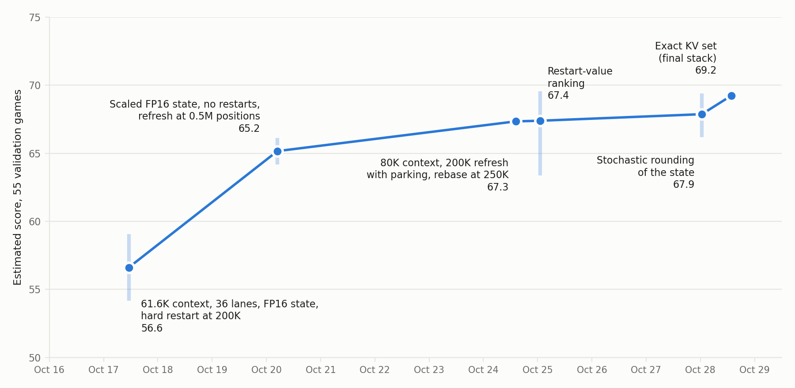

# ARC-AGI-3: solution write-up

I would like to thank the ARC Prize Foundation and Kaggle for hosting this competition. I have been a fan of ARC-AGI since my early days on Kaggle. I had never entered before, as I had no approach I found viable, but I always read the winning solutions and kept up with the news. A couple of weeks before the second milestone prize, movement on the public leaderboard led me to @chiefkeith's Qwen3.8-Flash-Next notebook, and I immediately saw a lot of room for improvement. My experience from the AIMO competitions suggested that a capable base model behind a well-optimized inference pipeline can do very well without any training, while RL without distillation from a stronger teacher may not pay off.

The second-milestone solutions confirmed this direction, and I learned a lot from them, especially from @dfranzen's. Compared with theirs, my pipeline was less token-efficient, partly because of its shorter context and partly because of its 4-bit KV cache, which led me to look closely at output quality and numerical precision. For offline validation, I used the 25 public evaluation games together with 30 custom games selected from those made by @sonphamorg and @markbarney ([gallery](https://arc.markbarney.net/arc3/gallery)).

## 0. Summary

We ran Intel's W4A16 AutoRound quantization of Qwen3.8-Flash-Next on a single RTX PRO 6000, playing 28 games at once for 9 hours, each with an 82,528-token context, at about 1,600 tokens per second. With memory for only 28 of the 110 games at a time, the harness (§1) keeps each game in a persistent session, refreshes attempts that stall, and hands each freed slot to a waiting game through a priority queue. On the serving side (§2), most of our work went into raising throughput while keeping output quality close to a BF16 reference, through a 4-bit KV cache, a scaled FP16 format for the recurrent state and a fine-tuned MTP drafter proposing four tokens per step (K = 4).

The model has 48 layers: 36 Gated DeltaNet (GDN) linear-attention layers, each with a fixed-size recurrent state, and 12 query-sparse attention (QSA) layers, where an indexer picks, in groups of four, the 2,048 context tokens each query attends to.

## 1. Harness

Our harness builds on Tufa Labs' Duck framework by way of @dfranzen's milestone-2 agent: a single Python tool, per-action results, UNDO and RESET exposed, the board and a change image on every turn, and the model's functions kept between calls. We kept almost all of it; one small change worth noting is a stateful Python kernel, so that variables as well as functions persist between calls. Our main changes follow, roughly in order of importance (our judgment, since not every change was ablated in isolation).

1. **Persistent sessions with attention-guided eviction.** To avoid re-prefilling the conversation every turn, the client only appends new messages, and the server keeps each game's KV cache and recurrent state between turns. When a session's cache reaches 82,528 tokens, the server evicts about 20% of it in one batch. It protects the system prompt, the newest 16K tokens and the latest observation, and otherwise evicts the 4-token groups that the QSA indexers have selected least often; as a backstop, turns older than 120K tokens are evicted whole regardless of selection. Evicted tokens remain absorbed in the GDN layers' recurrent state. Evictions also respect the conversation's structure: formatting tokens are never evicted on their own, and an assistant turn with its tool output goes as one block, formatting included, once three quarters of its content is gone. Images are likewise evicted whole or not at all, and the notes and summary that open a conversation stay pinned until they rank among the least-selected tokens for several evictions in a row.

2. **In-level notes and refresh at 200K tokens.** The longer an attempt at a level runs, the less each token buys (table below, pooled over our last 15 validation runs). After 200K generated tokens on one level, the model therefore writes notes on what it has confirmed and what has failed, and a fresh conversation opens with those notes and its ten most recent functions, boards and actions.

   | Tokens spent on the level | Level clears per 1M tokens |
   |---|---|
   | 0-50K | 17.5 |
   | 50-100K | 13.7 |
   | 100-150K | 8.2 |
   | 150-200K | 6.0 |
   | First 50K after a refresh | 2.9 |
   | Next 50K | 5.2 |
   | 100-200K after the refresh | 3.5 |

   After a short re-orientation, a refreshed level clears somewhat below the 150-200K rate. For the level itself, the refresh changes little compared with simply continuing: 33% of the 532 refreshed levels cleared within the next 100K tokens, against 26% of the 236 levels that continued past 200K in eight earlier runs, and both reached 49% within 200K. A hard restart did not help either: in one pair of 4.5-hour runs on the 55 validation games, resetting the level at 200K cost 4.7 points of estimated score (§2.3; 90% CI over games -10.7 to +0.9). The refresh's main benefit is that it gives a stuck game a natural point to hand its lane to a waiting one (item 4).

3. **Rebase at 250K positions, with a moving system prompt.** Eviction bounds the cache, but positions keep growing, and the model was trained on at most 262K. Our first design extended the position range to 2M. On recorded game conversations, a system prompt 1M positions behind the text raised NLL by 0.042 nats and changed the top-ranked next token at 7.6% of positions, against 4.4% from rounding noise alone. So the server moves the prompt: it re-rotates the prompt's cached keys to keep it just behind the oldest cached token, which removes most of that loss (+0.003 to +0.011 nats at distances of 60K to 240K).

   Long conversations still played worse. Across four long runs (12 to 18 hours), stalls, where the model gives up and repeats cheap actions, never began below 262K positions but reached 7.6 per 10K turns beyond 1M, and at a given level the odds of a first-attempt clear roughly halved per 250K positions already used. This is what one would expect beyond the trained range. At 250K positions the server therefore rebuilds the conversation from position 0, keeping at most 60K tokens after the model writes a summary; a level already past 150K tokens gets the refresh instead.

4. **Priority queue with parking.** With only 28 sessions in memory, lanes must be shared. Games that have not started go first. A game that reaches its refresh while others wait is parked: its session keeps the token history but frees its KV cache, and later resumes from a rebuilt context of at most 60K tokens. Parked games are banded by how often they have parked on the current level (a level-up resets the count), so a game that keeps stalling yields to fresher ones, and ranked within a band by a restart value: an estimate of the share of the game's score it can still earn in the time left.

   In one 9-hour, 110-game rehearsal, the median game started after 1.9 hours and the last after about 5 hours. In a pair of 110-game runs stopped at 3 hours, the arm with parking had cleared 278 levels against 234 after about two hours and started 74 games against 55. In one pair of 9-hour, 110-game runs, the restart value beat first-in-first-out by 3.5 points of estimated score (90% CI -2.0 to +9.0).

5. **Level-up summaries.** The levels of a game share their mechanics, so when a level is cleared the model saves a short summary of its rule. The next level opens with it, and all earlier summaries can be read from Python.

## 2. Serving

### 2.1 Throughput

Memory sets the number of lanes, so most of our throughput work went into fitting more of them. The KV cache is 4-bit (296 bytes per token and KV head for keys and values together, against 520 for FP8; §2.2), the drafter's KV and other per-session state moved out of vLLM's shared KV pool, and the input embedding table moved to host memory (1.18 GiB). The 97 GiB per-layer embedding (PLE) table lives in host memory anyway; we replaced the per-step message between its host process and the GPU worker with a pinned buffer and a flag that a GPU kernel polls (+2.3 to 3.7% throughput).

Persistent sessions mean each turn prefills only its new message. For speculative decoding we use the model's MTP drafter with K = 4. Stock vLLM rolls back rejected drafts by keeping a snapshot of the recurrent state for every draft position in each of the 36 GDN layers. We keep one state per lane and, at the next step, recompute it through the accepted drafts only, in the chunked (WY) form of the delta rule. Memory then does not grow with the number of drafts, and the GDN layers run faster: 3.30 ms per step in a 37-lane benchmark, against 7.37 ms with stock vLLM and 2.85 ms without drafts. We also fine-tuned the drafter on about 300M tokens of our own gameplay, in BF16 with its routed experts frozen: on held-out games the tokens emitted per step rose from 3.03 to 3.35, and live gameplay averages 3.57.

Profiling found the rest:
- an exact radix top-k in place of a sort for the QSA indexer's selection (119 to 6.9 µs per call);
- a register-spill fix in the attention kernel that reads the 4-bit cache (a large prefill from 221 to 5 ms);
- constant-time KV accounting in vLLM's scheduler (5.3 to 0.7 ms per step);
- new requests and evictions prepared while the GPU runs the current step (+3.8%);
- split-K kernels for the dense layers' small BF16 matrix multiplications (3.47 to 2.91 ms per step).

The final stack serves 28 games at about 1,600 tok/s, with the GPU about 98% busy during decoding.

### 2.2 Precision and output quality

Every serving change had to reproduce the reference output bit for bit unless we accepted it as lossy.

**How we measured.** The stack is deterministic (the MoE runs in a canonical token order), so the NLL of a fixed scoring set, computed at every launch, must match bit for bit. For lossy changes the yardstick is a noise floor: even a one-ulp perturbation moves the next-token distribution by a KL of about 0.013, because near-ties in expert routing and sparse-attention selection flip and the flips propagate. We judged each lossy choice by its KL in excess of that floor, on gameplay text deep into long conversations and at the action tokens inside tool calls. NLL alone was not enough: the recurrent-state defect described below moved the NLL of generated tokens by only 0.06%.

**4-bit codebook KV.** We screened KV formats by simulated quantization on 8 recorded gameplay conversations. The winning format treats each 256-dimensional key or value vector of a head as follows:

- **Centering:** subtract a per-layer, per-head mean (restored on read), which shrinks the range the codes must cover.
- **Rotation:** multiply by the normalized Hadamard matrix, which is orthogonal, so attention scores are preserved, and which spreads outlier channels so that the coordinates look close to Gaussian.
- **Codebook:** store each coordinate as a 4-bit index into the 16 Lloyd-Max levels for a Gaussian; the attention kernel evaluates a level as a short polynomial of its index.
- **Scales:** give each block of 16 coordinates an E4M3 scale that minimizes the block's squared error, under one FP32 scale per vector.

This comes to 148 bytes per key or value vector, in NVFP4's byte layout.

The table compares it with the alternatives we screened, by excess KL as a multiple of ours, where

```math
\text{excess KL} = \mathrm{KL}(\text{BF16 cache} \,\|\, \text{format}) - \text{one-ulp floor}
```

The rows come from two screens with different panels, each of which also measured our format, so only the ratios are comparable across rows; in the main screen ours reads 0.0211 against a floor of 0.0129.

| Format | Bytes per token and KV head (K+V) | Excess KL (multiple of ours) |
|---|---|---|
| FP8 E4M3 | 520 | 0.33 |
| **Ours: rotated codebook, MSE scales, centered** | **296** | **1.0** |
| Ours with scales shared by 4-token groups | 266 | 1.16 |
| Rotated NVFP4, MSE scales | 296 | 1.7 |
| Plain NVFP4 | 296 | 2.1 |
| Keys or values at 3 bits | 264 | 2.1-2.3 |
| Keys and values at 3 bits | 232 | 3.3 |
| Values at 2 bits | 232 | 6.3 |

Our format changes the top-ranked next token about as often as FP8 does (at 3.6% of positions against 3.5%). Centering mattered most for the drafter, whose keys are dominated by a shared mean (98.5%): moving the drafter's KV to the centered codebook raised its acceptance from 2.65 to 2.80 tokens per step in a short gameplay run (at K = 3). Sharing the block scales across 4-token groups would have bought about 2.6 lanes but showed no score gain in paired runs, so we left it out (§3).

**Exact window.** On long gameplay sequences (up to 128K tokens), the codebook made the model more sensitive to perturbation: the KL at action tokens between two runs differing only in batch order rose from about 0.06 to 0.10, and the NLL of generated tokens rose by about 0.5%. Much of the attention lands on recent tokens, so each QSA layer also keeps its newest tokens in BF16 and combines the two partial attention results in FP32. A 256-token window recovered 61% of that NLL gap (95% CI 30-90%) for about a third of a lane. The final window holds the newest 1,280 tokens plus a 352-slot exact set: the first 64 prompt tokens, which act as attention sinks, and the 288 tokens the indexer selects most often, kept in BF16 when they leave the window. On our KL panel the exact set matched 352 more recent tokens and did better at the system prompt's positions (KL 0.260 against 0.274), at no throughput cost. The cache's remaining cost on model-written text is an excess KL of about 0.004 nats per token.

**GDN recurrent state.** Each head of a GDN layer carries a state matrix *S* updated by a gated delta rule, with key *k*, value *v*, query *q*, write strength *β* and decay *α* at token *t*:

```math
S_t = \alpha_t\, S_{t-1}\left(I - \beta_t k_t k_t^\top\right) + \beta_t v_t k_t^\top, \qquad o_t = S_t q_t, \qquad \alpha_t = e^{g_t} \in (0, 1)
```

The decay is computed in FP32, but vLLM stores *S* in BF16, once per speculative step (about every 4 tokens). When the decay accumulated between two stores is below half a BF16 unit in the last place (about 0.2%), rounding returns the old value, so heads whose horizon 1/(1 − *α*) exceeds about 2K tokens stop decaying and their state stagnates on old memory (for FP16 the threshold is about 8-16K). We ran an FP32 copy of the state alongside and measured each head's readout error, the relative error of its output:

```math
\text{readout error} = \frac{\lVert (S - S_{\text{exact}})\,q \rVert}{\lVert S_{\text{exact}}\,q \rVert}
```

It grew with the horizon, from 0.17% in heads with horizons below 64 tokens to about 15% in the long-horizon heads at positions 96-128K, biased toward stale memory. The NLL of the observation text that the harness appends rose by 1.3%, and the KL at action tokens was more than twice the floor at positions 96-128K (0.162 against 0.072).

| State format | Long-horizon readout error | Effect and cost | Decision |
|---|---|---|---|
| BF16 (vLLM default) | about 15% at 96-128K | decay lost to rounding; long-horizon state stagnates | replaced |
| FP16 | 6.8 times lower, but 7.5-12% past 128K | closed 97% of the NLL gap to FP32 | interim |
| FP16 with an FP32 scale per 32 state rows | at most 2.5% | decay goes into the scale, so it is never rounded away; scales fit in page padding | adopted |
| plus stochastic rounding of the store | 0.8-1.0% instead of 1.5-2.5% beyond 16K horizons (emulated) | +0.13 ms per step | adopted (final stack) |
| FP32 | 0 | two fewer lanes, 6% fewer tokens; same score | rejected |

The stochastic rounding adds 13 bits of hash noise before truncation, so a store is unbiased in expectation yet deterministic. Because vLLM sizes the attention pages to match the state's page, an FP32 state would have doubled the page and cost two lanes: 1,575 against 1,677 tok/s, and 60.3 against 61.1 estimated points, a tie. We could not isolate the fix's score effect, because it arrived together with the in-level refresh.

**Exact speculative sampling.** With rejection sampling, speculative decoding should sample exactly from the target model. In the vLLM version we used it did not, because of two bugs since fixed upstream: the correction token drawn after a rejection reused the Gumbel noise that had selected the rejected draft (a total-variation error 17 times the floor of an exact sampler), and a request resumed after a pause could verify drafts that were never proposed for it. We fixed both.

### 2.3 Validation

We validated on 55 games: the 25 public games and the 30 custom games from the introduction, a set the gallery then listed as "copycat 30". A run lasted 4.5 hours, and most runs came in A/B pairs. Each run was scored with an estimate of the official score: level-weighted completion times the action efficiency measured on the public 25, since the custom games have no action baselines. One pair resolves only differences of about 9 to 13 points, so Figure 1 shows how the changes accumulated over the last two weeks rather than their individual effects.



*Figure 1. Estimated validation score at each stage of the stack (stage mean; bars span the runs' range).*

Exploratory runs, runs at other context lengths and a rejected expert requantization are left out. By October 17, the throughput work of §2.1 had taken the stack from about 850 tok/s in September to about 1,850 tok/s at 61.6K context with 36 lanes; a level stuck at 200K tokens was then restarted with RESET after the model wrote notes, and the estimate stood at 56.6. The scaled FP16 state, the replacement of hard restarts by an in-level refresh (then at 0.5M positions) and other harness changes landed together and lifted it to 65.2 by October 20. The next stage combined the 200K refresh with parking, a longer context (about 80K tokens at about 1,600 tok/s; contexts from 90K up to 120K did not improve further) and the rebase, and reached 67.3 by October 24. The restart-value ranking, stochastic rounding and the exact KV set then each moved the score within noise, and the final stack reached 69.2, about twelve points above October 17. The public leaderboard later scored our final submissions about ten points below these estimates (57.97-58.59), so our offline validation overestimated the score by roughly that much.

## 3. What else we tried

- **Training-free depth recursion.** An early experiment, based on the intuition that the middle layers carry most of the reasoning: we ran a block of middle layers twice, without any training. It raised NLL by 0.06 to 0.10 nats and broke tool calls at once. In an early run on the 25 public games it made 28 malformed calls, against 0 or 1 without recursion, and cleared 16 levels against 44 in the first 37 minutes.
- **Expert pruning.** Removing the 16 least-used of the 512 experts in each layer freed 1.8 GiB, enough for two more lanes, at a KL cost of at most 0.005; we used it only in a late variant (next item). Deeper cuts by routing frequency failed when we tried them on the same model for ARC-AGI-2: keeping 320 of 512 experts scored 7.5 points lower at matched progress, and keeping 256 made 31 of 39 early sessions stop calling tools. Other ranking criteria did no better: on KL, REAP and HOPE rankings matched frequency ranking within noise or were worse. In hindsight the problem was the recipe, not the ranking: we neither protected the experts that tool-call syntax depends on nor distilled from the unpruned model to repair the pruned one. We expect protecting those experts to be enough for ARC-AGI-2, but for ARC-AGI-3 a deep cut without a repair step would likely cost substantial token efficiency.
- **Further quantization.** Several lower-precision choices freed memory for 2 to 9% more tokens but had a measurable KL cost: FP8 dense layers, an FP8 output head and PLE table, FP8 indexer keys, 4-bit expert activations (the W4A4 NVFP4 release), and every grouped or sub-4-bit KV format. We found no score gain from any of them, and a late submission with FP8 attention input projections and expert pruning, at 32 lanes, drew 57.97 on the public leaderboard, against 58.28 and 58.59 without them. What they gained in throughput they lost in token efficiency: grouped KV scales with expert pruning, for example, needed 5 to 20% more tokens than our main configuration to clear the same levels. Without a distillation step to repair the quantized model, the extra throughput was at best a wash for us.
- **Offloading to host memory.** We also evaluated moving cold experts to host memory, and a two-tier KV cache with its cold tier in host memory (as in HiSparse). At our concurrency we estimated under 5% more throughput for either, and adopted neither.

## 4. What we did not get to

- **KV compactor.** The idea came from Astra's near-perfect performance on the ARC-AGI-3 semi-private evaluation with the "Provider Adapter" harness, which includes context compaction. Our stack already compacts in two ways: in text, with notes at a refresh and a summary at a rebase, and in the cache, by evicting the least-selected tokens. A learned KV compactor would instead compress the cache itself: a small network, trained against the frozen base model, replaces a long stretch of cached keys and values with a much shorter set in a single forward pass. We considered a compactor of this kind at roughly 10-20× compression. We expect it to pay off with a longer context limit, but within our memory budget the persistent cache with indexer-guided eviction already worked well.
- **Test-time adaptation.** Test-time adaptation was key to winning earlier ARC Prize competitions on Kaggle, but gradient updates on a model of this size are not feasible on a single RTX PRO 6000. Borrowing from the compactor idea, a lightweight network could instead generate LoRA adapters from completed levels and merge them into the model. Where a compacted cache is short-term working memory for the current attempt, such adapters would be long-term memory: what the model learned on earlier levels would live in its weights rather than in its context. This could plausibly work, but it is a preliminary idea, and the training recipe needs more thought.

## 5. Closing thoughts

- **Submit early.** We kept postponing our first full-stack submission: each time we were ready to move to Kaggle, the top of the leaderboard had moved, and we went back to improving the solution. An early submission would have revealed the roughly ten-point gap between our offline validation and the leaderboard (§2.3) while there was still time to act on it.
- **We concluded too early that we had plateaued.** After our final validation runs we decided that neither more throughput nor a better harness would close the gap to the top, and that the only plausible gains left were in distillation and RL. That assumption stopped us from exploring further, and we spent our last days on ARC-AGI-2 instead. The 1st- and 2nd-place write-ups show that the conclusion was wrong.
- **On working with AI agents.** I only started automating my workflow with Codex and Claude Code near the end of my previous competition. This solution was built with their help, and so was this write-up; they proposed ideas as well as implementing and testing them, and greatly increased the pace at which I could iterate. For now, a person working with these agents still does better than either alone, and many people are wondering how long that will last, and whether agents will soon win Kaggle competitions like this one on their own. I have no special insight here, only my experience from this competition, and I may well be wrong. My hope is that they will not, at least not entirely. It may not be economically viable to turn every long-horizon task of this kind into an RL environment with a reliable reward, since each rollout would be very long and slow to run. And over horizons that long, even with compaction, context remains a limiting factor.
